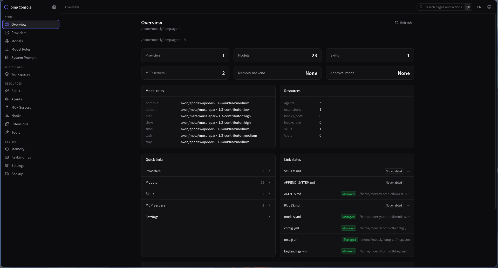
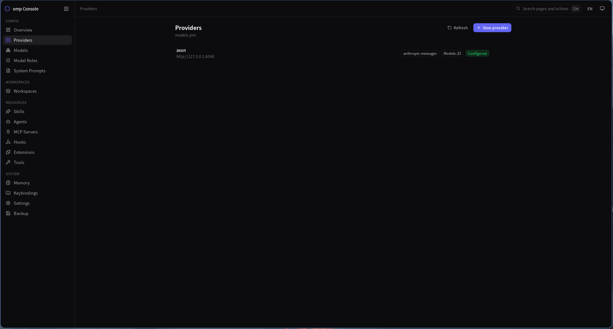
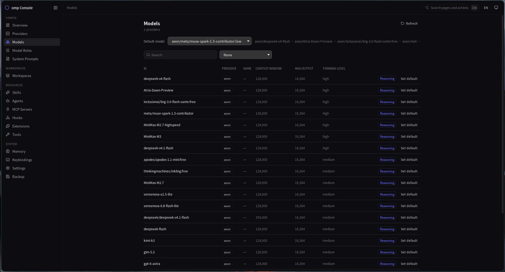
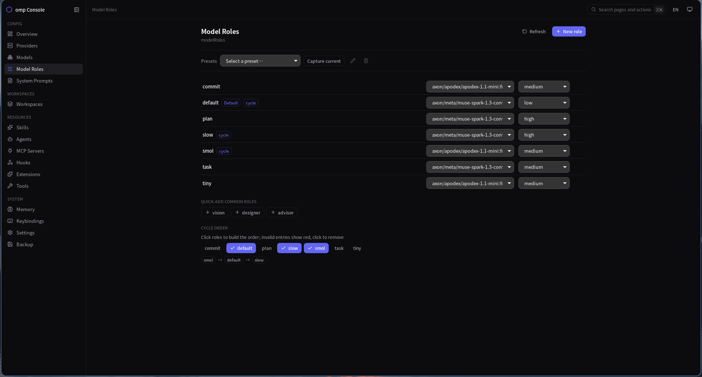
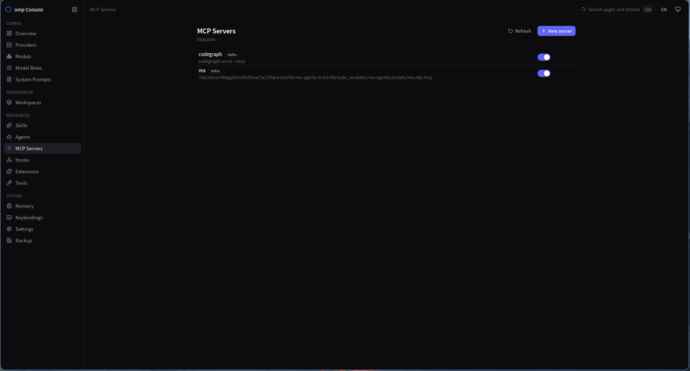
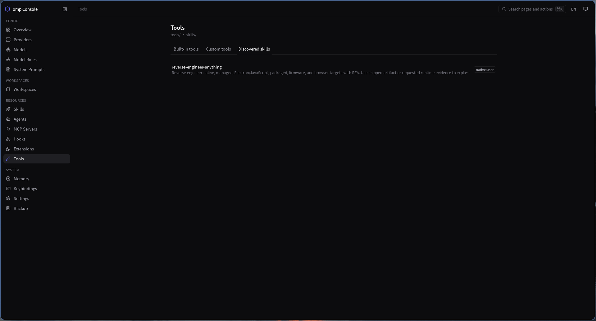
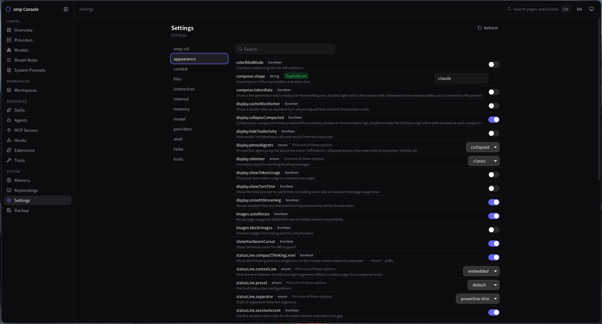

# omp-ctl

管理 [omp](https://omp.sh) 配置的桌面 GUI（Tauri 2）。

[English](README.md) | 简体中文



## 功能

- **Provider 与模型**（`models.yml`）：浏览 / 新建 / 编辑 / 删除 provider，编辑每个 provider 的模型列表，探测 provider 的 `/v1/models`，将任一模型设为默认（写入 `config.yml` 的 `modelRoles.default`）。
- **角色与轮换顺序**（`config.yml` 的 `modelRoles` + `cycleOrder`）：角色到模型的映射行，外加模型轮换顺序。
- **预设**（`presets.yml`）：整套 `modelRoles` + `cycleOrder` 的命名快照。受管模式——选中预设即整套应用，此后每次改动同时写回 `config.yml` 和该预设，没有覆盖按钮。应用预设会清工作区 active 指针（工作区快照经 `sync_active_roles` 跟随）。
- **工作区**（`workspaces/<名>/`）：MCP 服务器、六类资源、四个提示词文件、roles + cycleOrder + disabledAgents 的快照。保存即捕获当前状态，应用即整套覆盖；选中工作区后各变更命令尾部 `sync_active_quiet()` 自动同步快照。
- **MCP 服务器**（`mcp.json`）：增删改查，外加启用开关。
- **资源**（skills / agents / hooks / extensions / tools / memory）：skills 为 `SKILL.md` 目录布局，其余为按扩展名管理的文件；非托管条目可接管，外部条目保持只读。
- **提示词**（`APPEND_SYSTEM.md`、`RULES.md`、`AGENTS.md`、`SYSTEM.md`）：每个文件独立的链接开关，可编辑内容、可还原备份；非托管文件走接管流程，绝不改写外部目标。
- **快捷键**（`keybindings.yml`）：22 个内置动作，带组合键校验（必须以按键结尾，不能以修饰键结尾）；文件里未知的 action 原样保留、可编辑。
- **设置**：按 `omp config list` 解析出的 tab 分组的可搜索表格，带 `configured` 标记；设置 / 重置走 omp CLI。
- **备份与快照**：导出在 `backup/` 下生成 `migrate-<时间戳>.tar.gz`，覆盖 config、models、mcp.json、keybindings.yml、`.links.json`、受管文件和全部资源目录；导入先 stage 到临时目录，拒绝 symlink 条目和空快照。`defaults.yml` / `presets.yml` 是 omp-ctl 自有功能，不进快照。
- **默认值**（`defaults.yml`）：新建模型 / 角色时套用的默认值，外加备份开关 `backup: {enabled, keep}`（默认关闭 / 保留 5 个）。

## 截图














## 安装

**Arch Linux（AUR）**——两个包互斥（`provides`/`conflicts`）：

```sh
yay -S omp-ctl      # 从源码构建（需要 bun + cargo，LTO release 要几分钟）
yay -S omp-ctl-bin  # 预编译包：直接展开 release 的 .deb，仅 x86_64
```

包定义在 [`packaging/aur/`](packaging/aur/)。

**其它平台**：从 [Releases](https://github.com/moecly/omp-ctl/releases) 下载——Windows 用 `.exe`（NSIS）/ `.msi`，macOS 用 `.dmg` / `.app.tar.gz`，Linux 用 `.deb` / `.rpm`。AppImage 只有本地 `just build` 产出，CI 不提供。

## 核心概念

`~/.omp-ctl/` 是唯一真实来源；`~/.omp/agent/` 下的条目是以符号链接指向它的。

链接状态是三态而非开关（`Absent` / `Managed` / `Unmanaged`）：config 和 models 是常驻文件，所以「关闭」后 store 里依然有内容。

- 关闭功能 = 移除链接（内容留在 store，不丢失）。
- 开启功能 = 建立链接。
- 首次接管把原始文件/链接复制进 store，原件移入 `~/.omp-ctl/backup/`（记在 `.links.json`）；还原时移回去，store 副本保留。

## 开发

`just dev` 启动 Tauri 窗口；`beforeDevCommand` 会自动拉起 Vite。不要再另开一个 `just serve`——`strictPort: 1420` 会冲突。`just serve` 只用于单独调试前端。

| 命令 | 说明 |
|---|---|
| `nix develop` | 进入开发 shell（rust-overlay + Tauri/WebKit 依赖） |
| `just web-install` | `cd web && bun install` |
| `just web-check` | 前端类型检查（`tsc --noEmit`） |
| `just web-build` | 构建前端到 `dist/` |
| `just serve` | 1420 端口跑 Vite，仅前端 |
| `just dev` | Tauri 窗口（Vite 自动启动） |
| `just check-rust` | `cargo check` |
| `just test` | Rust 测试 |
| `just build` | `cargo tauri build`（本地还会产出 AppImage） |
| `just fmt-rust` | `cargo fmt` |

Wayland 下 WebKit 渲染错乱：`WEBKIT_DISABLE_DMABUF_RENDERER=1 GDK_BACKEND=x11`（已 baked 进 `just dev`）。

前端在 `web/`（React + TypeScript + Vite + Tailwind v4，`bun` 管理依赖）。

## 发布

1. 升版本号，共四处但只有前两处要手改：
   * `src-tauri/Cargo.toml` 的 `version`
   * `src-tauri/tauri.conf.json` 的 `version`（决定 deb/rpm/msi 产物的版本号）
   * `Cargo.lock` —— 由 cargo 自己刷新，**必须一起提交**：AUR 构建用
     `cargo build --release --locked`，lock 里 `omp-ctl` 的旧版本号会让它直接失败
     （本地 `just build` 不带 `--locked`，会静默修好 lock，所以只有 AUR CI 会暴露）。
     `cargo check` 或任意不带 `--locked` 的 cargo 命令都会顺手刷新它。
   * `packaging/aur/*/PKGBUILD` 不用动：`publish.sh` 按 tag 重写 `pkgver`/`pkgrel`/`sha256sums`，
     发布成功后还会把改写结果**写回仓库**，所以仓库里的 PKGBUILD 永远等于 AUR 上的版本。
2. 打 tag 并推送：`git tag v0.8.1 && git push origin v0.8.1`。
   **tag 必须打在包含 `packaging/aur/` 最新内容的提交上**：`aur` job 用的是 tag 树里的
   包定义与 `publish.sh`，打在旧提交上会拿旧脚本发布（0.7.0 就这么丢过 `omp-ctl-bin`，
   而且发出的 `omp-ctl` 是缺 `custom-protocol` 的旧 PKGBUILD 编出来的）。
3. `release.yml` 的 `release` job 在三平台打包并建出 GitHub Release（deb / rpm / nsis+msi / app+dmg，CI 不出 AppImage；本地 `just build` 会额外产出 AppImage）。
4. 同一个 workflow 的 `aur` job（`needs: release`）在 Arch 容器里对
   `packaging/aur/` 下的每个包各跑一次 `publish.sh <tag> 1 <包名>`（matrix + `fail-fast: false`，
   一个包失败不影响另一个），把 PKGBUILD 与 .SRCINFO 推到 AUR。
   需要仓库 secret `AUR_SSH_KEY`（AUR 账户里登记的 ed25519 私钥，无口令）。
   不能拆成独立 workflow：release 由 `GITHUB_TOKEN` 创建，GitHub 不会用它触发新 workflow。

手动补发（本地，用 `~/.ssh/aur`，`AUR_KEY_FILE` 可改）：

```sh
packaging/aur/publish.sh v0.8.1              # 全部包，pkgrel=1
packaging/aur/publish.sh v0.8.1 2 omp-ctl    # 只发 omp-ctl，pkgrel=2（同版本重打包）
```

本地 `makepkg` 手动试打（在 `packaging/aur/omp-ctl/` 里复制 PKGBUILD 到空目录再 `makepkg -f`）
必须带上 `--features tauri/custom-protocol`——PKGBUILD 已经写了，别删：缺了它编出来的是
dev 模式二进制，运行时去连 `127.0.0.1:1420`（Vite）而不是内嵌前端，装完打开就是个连不上的窗口。

AUR 账户与密钥准备：

1. 到 <https://aur.archlinux.org/register/> 注册。**注册不设密码**：账户先以空密码 + resetkey
   落库，必须点开邮件里的设置密码链接才可用 —— AUR 的 git 认证在 SQL 里显式要求
   `NOT Users.Passwd = ''`（`aurweb/git/auth.py`），没走完这一步的账户即使公钥已登记，
   SSH 也永远是 `Permission denied (publickey)`。
2. `ssh-keygen -t ed25519 -f ~/.ssh/aur`，登录后把 **`~/.ssh/aur.pub`** 内容填进
   <https://aur.archlinux.org/account/> 的 `SSH Public Key` 并保存。
3. 把 **`~/.ssh/aur` 私钥全文**（含 `BEGIN/END` 行，不是 `.pub`）存成仓库 secret `AUR_SSH_KEY`。

AUR 的 SSH 认证条件只有三条（`aurweb/git/auth.py`）：该公钥存在于此账户、账户未被
suspended、账户已设密码。`Permission denied (publickey)` 必然是不满足其中之一，与 GitHub 侧
配置无关。`publish.sh` 每次运行先打印所用私钥指纹并校验私钥可用；CI 另有一页直接探测
`aur@aur.archlinux.org` 的认证，失败时用 `::error::` 指出上述原因。

## 目录结构

```
~/.omp-ctl/
├── models.yml            # 托管后的真实文件
├── config.yml
├── mcp.json
├── keybindings.yml
├── defaults.yml          # omp-ctl 自有，不进快照
├── presets.yml           # omp-ctl 自有，不进快照
├── SYSTEM.md  APPEND_SYSTEM.md  AGENTS.md  RULES.md
├── models.yml.bak.<时间戳>  # 写前备份（开启后才有，就地存放）
├── .links.json           # 托管记录（原目标、备份名）
├── workspaces/<名>/      # 各工作区快照 + workspace.json
└── backup/               # 接管前的原始条目 + migrate-*.tar.gz 快照
```

`~/.omp/agent/` 中的对应条目为指向上述文件的 symlink。

## agent 目录解析顺序

1. `omp config path`
2. `PI_CODING_AGENT_DIR`
3. `OMP_PROFILE` / `PI_PROFILE`（跳过 `default`、`blank`）
4. `$XDG_DATA_HOME/omp/agent`（仅当目录存在）
5. `$HOME/.omp/agent`

解析结果在进程内经 `OnceLock` 缓存（`cfg(test)` 下不缓存）。集成测试跑真实 agent 目录，解析失败时自行跳过。

## 写盘策略

- 写前备份走 `backup_file`，受 `backup.enabled` 开关控制（**默认关闭**）；`keep` 默认 5，钳在 0–100，超出的 `.bak.<时间戳>` 同级裁剪。
- 所有写入经临时文件 + `rename` 原子替换（`store::write_atomic`）。
- YAML 采用行区间替换（`yaml.rs`），保留注释与未建模字段。
